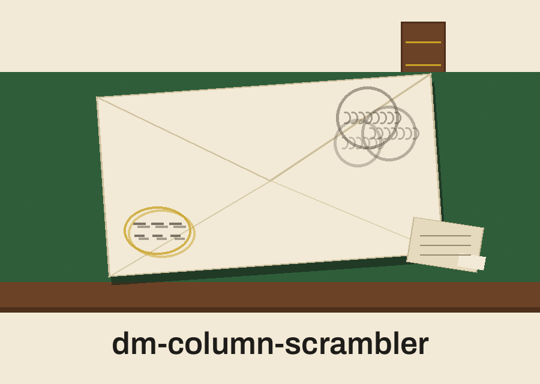

# dm-column-scrambler

Title block: the name above is set as a catalogue entry in the author first manner, the repo name in Brygada 1918 in library green on dust cream, a small date stamp image at the left of each heading, the dead letter kept small enough to read as punctuation rather than decoration.

# dm-column-scrambler
Scrambles the order of columns in a CSV file while preserving headers, to obscure data relationships.  Uses `csv` module. - Focused on Tools designed to generate or mask sensitive data with realistic-looking but meaningless values

## Install
`git clone https://github.com/ShadowStrikeHQ/dm-column-scrambler`

## Usage
`./dm-column-scrambler [params]`

## Parameters
- `-h`: Show help message and exit
- `input_file`: The input CSV file
- `output_file`: The output CSV file. It must not be the input file: if the output path resolves to the input file, through the same spelling, a `./` spelling, an absolute path, or a symlink, the run refuses and exits 1 before any file is written.
- `--seed`: No description provided

> Catalogue entry: output resolving to the input is refused before any writing, so the input survives a mistaken invocation untouched.

## Row width rules
- A data row with more fields than the header is refused: the run exits 1 naming the row and its field count, so no field is silently discarded.
- A data row with fewer fields than the header is padded with empty fields, and the run logs a warning naming the count and the padded rows.

> Catalogue entry: long rows are refused rather than trimmed, so no value is discarded quietly.

> Catalogue entry: short rows are padded and the padding is logged, with row numbers, counting the header as the first row, so the first data row is row two.

> Catalogue entry: a seed repeats a run only at the same column count, because the permutation length changes with the header.

## License
Copyright (c) ShadowStrikeHQ

## Catalogue notes, gathered at the counter

The buttons of this re-skin read Shuffle the Columns, Shuffle With This Seed, and Consult the Catalogue. Its headings read One Permutation, Shared, Refused if It Points Home, Short Rows Padded, Long Rows Refused, and Same Seed, Same Width, Same Order. Two facts are entered once more at full size: one permutation of column positions is drawn once and applied to the header and then to every row in turn, and the repository LICENSE file carries the MIT License, its holder line giving a pen name together with a single initial for the remaining name.
